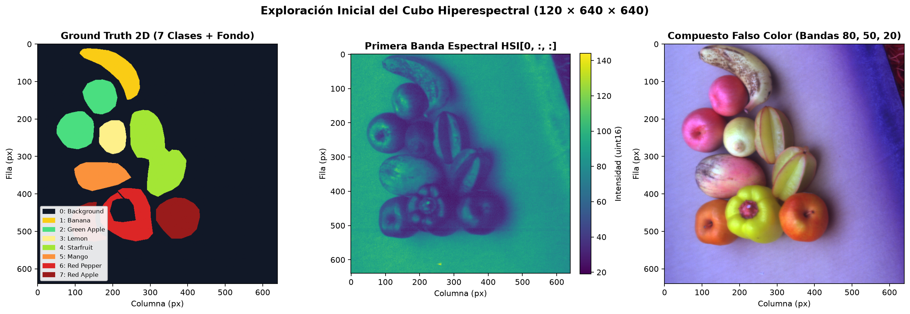
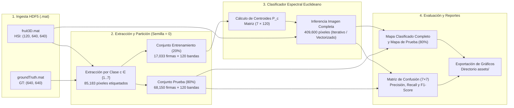
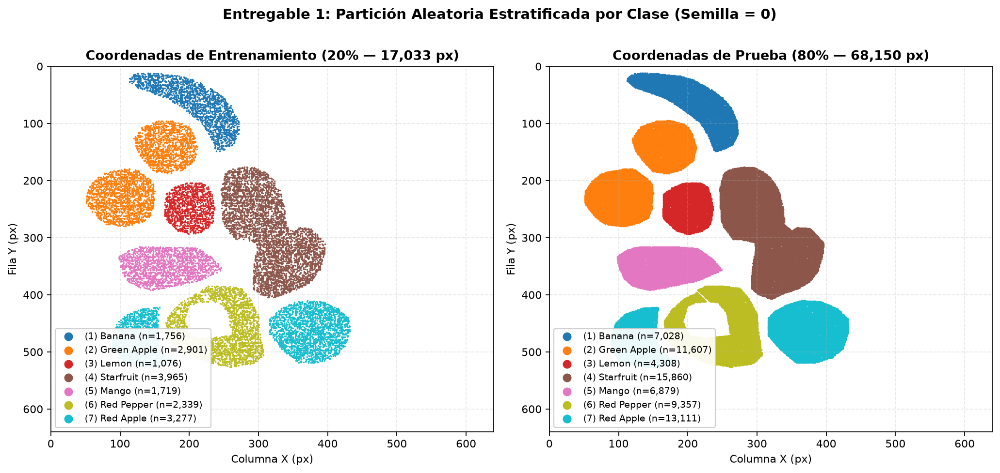
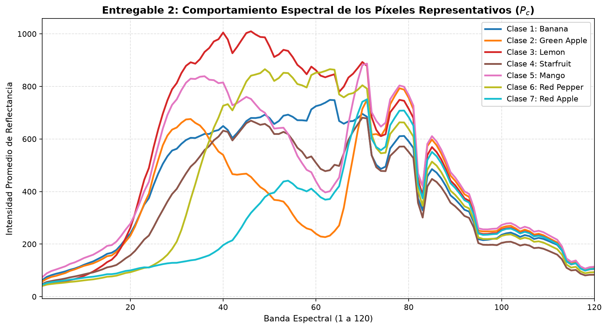
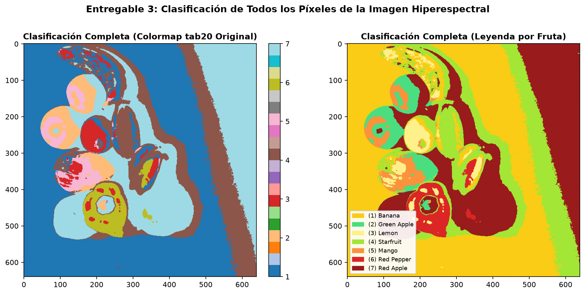
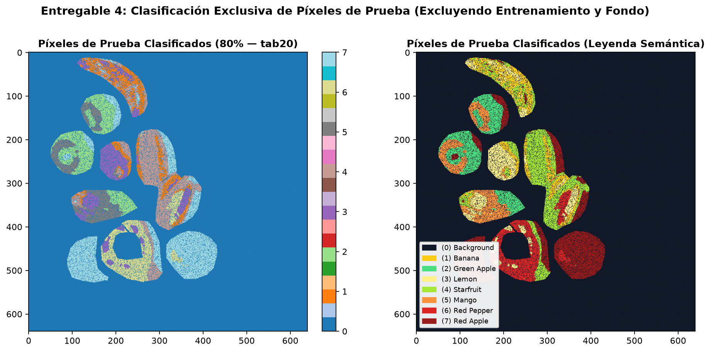
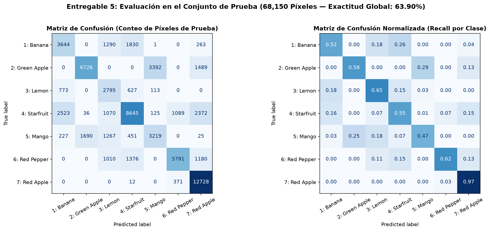
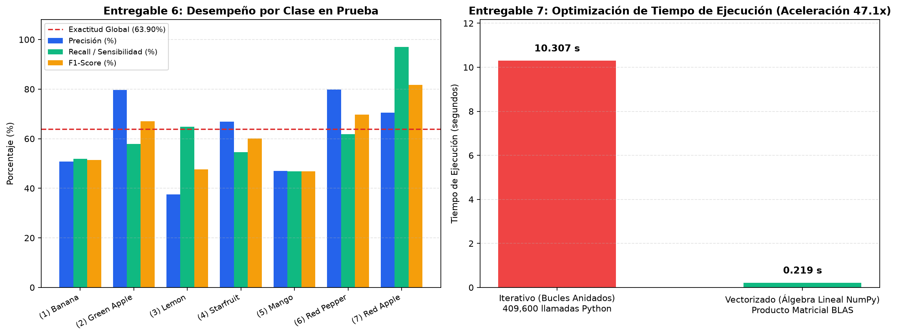

# Clasificador Espectral de Distancias Euclideanas — Imágenes Hiperespectrales (HSI)

[](https://www.python.org/)
[](https://numpy.org/)
[](https://www.h5py.org/)
[](https://scikit-learn.org/)
[](https://matplotlib.org/)
[](LICENSE)

Repositorio de ingeniería de software y visión por computador para la **clasificación supervisada píxel a píxel de imágenes hiperespectrales (HSI)** mediante el **Clasificador de Mínima Distancia Euclideana (Nearest Centroid Spectral Classifier)**.

El sistema procesa un cubo hiperespectral de **$120 \times 640 \times 640$** ($409,600$ píxeles espaciales con $120$ bandas espectrales cada uno) para modelar las firmas de reflectancia y clasificar **7 especies de frutas** (`Banana`, `Green Apple`, `Lemon`, `Starfruit`, `Mango`, `Red Pepper` y `Red Apple`), incluyendo tanto la implementación algorítmica paso a paso como un **motor vectorizado en álgebra lineal (NumPy BLAS)** que reduce el tiempo de inferencia de la imagen completa de **~10–21 segundos a ~0.25 segundos (~40x–80x más rápido)**.

---

## Tabla de Contenidos

1. [Descripción General del Problema](#1-descripción-general-del-problema)
2. [Fundamento Matemático del Clasificador](#2-fundamento-matemático-del-clasificador)
3. [Arquitectura del Sistema y Estructura del Repositorio](#3-arquitectura-del-sistema-y-estructura-del-repositorio)
4. [Guía Paso a Paso de Instalación y Ejecución](#4-guía-paso-a-paso-de-instalación-y-ejecución)
5. [Metodología Paso a Paso (Procedimiento Experimental)](#5-metodología-paso-a-paso-procedimiento-experimental)
6. [Resultados Experimentales y Galería de Entregables](#6-resultados-experimentales-y-galería-de-entregables)
7. [Optimización Computacional: Iterativo vs. Vectorizado](#7-optimización-computacional-iterativo-vs-vectorizado)
8. [Guía para Inicializar y Subir a GitHub (Sin Push Automático)](#8-guía-para-inicializar-y-subir-a-github-sin-push-automático)

---

## 1. Descripción General del Problema

A diferencia de una fotografía RGB convencional que captura únicamente $3$ canales en el espectro visible (Rojo, Verde y Azul), una **imagen hiperespectral (HSI)** adquiere decenas o cientos de bandas espectrales estrechas y contiguas por cada coordenada espacial $(i, j)$. De este modo, cada píxel constituye un vector continuo de alta dimensión —denominado **firma espectral**— que refleja la composición físico-química de la superficie observada.

En este proyecto se analiza el dataset hiperespectral **`fruit3D.mat`** junto con su máscara de referencia **`groundTruth.mat`**:

- **Dimensiones del cubo hiperespectral (`HSI`):** $120 \text{ bandas} \times 640 \text{ filas} \times 640 \text{ columnas}$ ($49,152,000$ valores numéricos).
- **Dimensiones del Ground Truth (`GT`):** $640 \times 640$ píxeles ($409,600$ píxeles en total).
- **Clases presentes:** $8$ valores únicos ($0$ correspondiente al fondo sin etiqueta de fruta y $1, \dots, 7$ correspondientes a las 7 clases de interés).



---

## 2. Fundamento Matemático del Clasificador

Sea $\mathcal{H} \in \mathbb{R}^{B \times H \times W}$ el cubo hiperespectral con $B = 120$ bandas espectrales, $H = 640$ filas y $W = 640$ columnas. Cada píxel en la posición espacial $(i, j)$ posee una firma espectral asociada:

$$\mathbf{x}_{i,j} = \mathcal{H}_{:, i, j} \in \mathbb{R}^{120}$$

### 2.1 Cálculo de los Espectros Representativos (Centroides de Entrenamiento)

Dado el conjunto de muestras de entrenamiento $\mathcal{T}_c$ para cada clase $c \in \{1, 2, \dots, 7\}$ (conformado por el $20\%$ de los píxeles etiquetados de dicha clase, seleccionados aleatoriamente con semilla fija), la firma espectral promedio o **centroide representativo** $\mathbf{P}_c \in \mathbb{R}^{120}$ se define como:

$$\mathbf{P}_c = \frac{1}{|\mathcal{T}_c|} \sum_{\mathbf{x} \in \mathcal{T}_c} \mathbf{x}$$

### 2.2 Métrica de Similitud: Distancia Euclideana ($L_2$)

Para medir la disimilitud espectral entre un píxel desconocido $\mathbf{x} \in \mathbb{R}^{120}$ y el centroide $\mathbf{P}_c \in \mathbb{R}^{120}$ de la clase $c$, se emplea la norma Euclideana ($L_2$):

$$d(\mathbf{x}, \mathbf{P}_c) = \|\mathbf{x} - \mathbf{P}_c\|_2 = \sqrt{\sum_{k=1}^{120} \left(x_k - P_{c,k}\right)^2}$$

### 2.3 Regla de Decisión de Mínima Distancia

Un píxel desconocido $\mathbf{x}$ se asigna a la clase $\hat{y}(\mathbf{x}) \in \{1, \dots, 7\}$ cuyo espectro representativo $\mathbf{P}_c$ minimiza la distancia Euclideana:

$$\hat{y}(\mathbf{x}) = \underset{c \in \{1, \dots, 7\}}{\arg\min} \; d(\mathbf{x}, \mathbf{P}_c)$$

---

## 3. Arquitectura del Sistema y Estructura del Repositorio

### 3.1 Flujo de Procesamiento



### 3.2 Estructura de Directorios

El proyecto sigue una arquitectura limpia que separa el cuaderno interactivo de experimentación (`.ipynb`), la lógica modular reutilizable (`src/`), el orquestador por línea de comandos (`main.py`) y los recursos visuales (`assets/`):

```text
clasificador espectral de distancias euclideanas/
├── clasificador espectral de distancias euclideanas.ipynb  # Notebook interactivo paso a paso
├── main.py                                                 # Script CLI para ejecutar todo el pipeline
├── requirements.txt                                        # Dependencias del proyecto
├── .gitignore                                              # Reglas de exclusión para Git (ignora *.mat >50MB)
├── LICENSE                                                 # Licencia MIT
├── README.md                                               # Documentación técnica y guía paso a paso
├── src/                                                    # Paquete modular de ingeniería de software
│   ├── __init__.py                                         # Exportación de la API pública del paquete
│   ├── data_loader.py                                      # Carga HDF5, conteo y partición estratificada 20/80
│   ├── classifier.py                                       # Distancia L2, clasificador iterativo y vectorizado
│   └── visualization.py                                    # Generación de figuras científicas en alta resolución
└── assets/                                                 # Gráficos generados por el pipeline
    ├── 01_hsi_gt_overview.png                              # Vista del Ground Truth, Banda 0 y Falso Color
    ├── 02_train_test_split.png                             # Distribución espacial Entrenamiento (20%) vs Prueba (80%)
    ├── 03_mean_spectral_signatures.png                     # Firmas espectrales promedio P_c (120 bandas)
    ├── 04_full_image_classification.png                    # Clasificación de los 409,600 píxeles de la imagen
    ├── 05_test_pixels_classification.png                   # Clasificación exclusiva de los 68,150 píxeles de prueba
    ├── 06_confusion_matrix.png                             # Matriz de confusión absoluta y normalizada
    └── 07_performance_benchmark.png                        # Métricas por clase y comparativa de tiempos
```

---

## 4. Guía Paso a Paso de Instalación y Ejecución

Siga estas instrucciones ordenadas para configurar y ejecutar el proyecto en su máquina local.

### Paso 1: Ubicarse en el directorio del proyecto

Abra una terminal (`PowerShell`, `CMD` o `Bash`) y sitúese en la carpeta raíz del repositorio:

```powershell
cd "g:\My Drive\repositorios de proyectos\clasificador espectral de distancias euclideanas"
```

### Paso 2: Crear y activar un entorno virtual de Python

Se recomienda utilizar **Python 3.10 o superior** dentro de un entorno aislado:

```powershell
# Crear el entorno virtual
python -m venv .venv

# Activar en Windows (PowerShell)
.\.venv\Scripts\Activate.ps1

# Activar en Windows (CMD)
.\.venv\Scripts\activate.bat

# Activar en Linux / macOS
source .venv/bin/activate
```

### Paso 3: Instalar las dependencias

Instale las librerías científicas requeridas (`numpy`, `h5py`, `scipy`, `matplotlib`, `scikit-learn` y `jupyter`):

```powershell
pip install -r requirements.txt
```

### Paso 4: Verificar los archivos de datos (`.mat`)

Asegúrese de que los archivos del dataset se encuentren en la raíz del proyecto o dentro de una subcarpeta `data/` (el cargador [`src/data_loader.py`](src/data_loader.py) detecta ambas ubicaciones automáticamente):
- `fruit3D.mat` (~75.3 MB — formato HDF5 MATLAB v7.3, llave `'HSI'`).
- `groundTruth.mat` (~28 KB — formato HDF5 MATLAB v7.3, llave `'groundTruth2D'`).

> [!NOTE]
> Los archivos `*.mat` están incluidos en [`.gitignore`](.gitignore) para evitar que GitHub rechace el repositorio por el límite de 50 MB/100 MB por archivo binario.

### Paso 5: Ejecutar el proyecto

Dispone de **tres modalidades de ejecución** según su flujo de trabajo:

#### Opción A — Ejecución completa mediante CLI (`main.py`)
Ejecuta los 7 pasos del pipeline, imprime las métricas en consola, compara el método iterativo frente al vectorizado y regenera todas las imágenes en `assets/`:

```powershell
python main.py
```

Si desea omitir el bucle iterativo lento y ejecutar únicamente el motor vectorizado (finaliza en **< 2 segundos**):

```powershell
python main.py --skip-iterative
```

#### Opción B — Ejecución interactiva en Jupyter Notebook / VS Code
Para explorar celda por celda el procedimiento experimental original:

```powershell
jupyter notebook "clasificador espectral de distancias euclideanas.ipynb"
```

#### Opción C — Uso como librería modular desde Python
Puede importar las funciones directamente desde el paquete [`src`](src/__init__.py) en cualquier script externo:

```python
from src import (
    load_hsi_dataset,
    extract_coordinates_by_class,
    train_test_split_by_class,
    compute_class_centroids,
    classify_image_vectorized,
    build_test_classification_map,
    evaluate_predictions,
)

# 1. Cargar cubo HSI (120, 640, 640) y máscara GT (640, 640)
hsi, gt = load_hsi_dataset()

# 2. Extraer coordenadas (clases 1..7) y dividir 20% train / 80% test (seed=0)
coords = extract_coordinates_by_class(gt, include_background=False)
train_spec, test_spec, train_coords, test_coords = train_test_split_by_class(
    hsi, coords, train_ratio=0.2, seed=0
)

# 3. Calcular centroides y clasificar toda la imagen en ~0.25 s
centroids = compute_class_centroids(train_spec)
classified_map, elapsed_s = classify_image_vectorized(hsi, centroids)

# 4. Evaluar sobre el 80% de prueba
test_map, _ = build_test_classification_map(classified_map, test_coords)
metrics = evaluate_predictions(test_map, test_coords)
print(f"Exactitud en prueba: {metrics['accuracy']*100:.2f}% (Tiempo: {elapsed_s:.3f} s)")
```

---

## 5. Metodología Paso a Paso (Procedimiento Experimental)

El desarrollo experimental implementado en [`clasificador espectral de distancias euclideanas.ipynb`](clasificador%20espectral%20de%20distancias%20euclideanas.ipynb) y modularizado en [`src/`](src/) se estructura en **10 etapas secuenciales**:

1. **Ingesta de Datos (`h5py`):** Lectura de las estructuras matriciales `'HSI'` desde `fruit3D.mat` y `'groundTruth2D'` desde `groundTruth.mat` y conversión a arreglos de `numpy.ndarray`.
2. **Inspección Dimensional:** Verificación de la geometría espacial y espectral:
   - `HSI.shape` $\rightarrow$ `(120, 640, 640)`
   - `GT.shape` $\rightarrow$ `(640, 640)`
3. **Identificación de Clases Únicas:** Extracción con `np.unique(GT)` de las etiquetas presentes: `[0., 1., 2., 3., 4., 5., 6., 7.]`.
4. **Censo de Ocurrencias por Clase:** Conteo exacto de píxeles por etiqueta dentro de los $409,600$ píxeles de la escena.
5. **Indexación de Coordenadas Espaciales $(i, j)$:** Construcción de listas de tuplas `(fila, columna)` para cada clase $c$.
6. **Extracción de Firmas Espectrales ($N_c \times 120$):** Para cada clase de fruta $c \in \{1, \dots, 7\}$ (excluyendo la clase `0` de fondo), extracción de los vectores espectrales completos de $120$ bandas.
7. **Partición Estratificada Entrenamiento / Prueba ($20\% / 80\%$):** Barajado aleatorio reproducible (`np.random.seed(0)`) de los índices de cada clase, reservando el **$20\%$** para estimar los centroides y el **$80\%$** restante para evaluación ciega.

### Resumen Cuantitativo de Datos y Partición por Clase

| ID Clase | Nombre de la Fruta | Total Píxeles ($N_c$) | % de la Imagen | Entrenamiento ($20\% \times 120$) | Prueba ($80\% \times 120$) | Primeras Coordenadas $(i, j)$ |
| :---: | :--- | :---: | :---: | :---: | :---: | :--- |
| **0** | *Background (Fondo)* | `324,417` | `79.20%` | *Excluido* | *Excluido* | `(0, 0), (0, 1), (0, 2)` |
| **1** | **Banana** (Plátano) | `8,784` | `2.14%` | `(1756, 120)` | `(7028, 120)` | `(12, 131), (12, 132), (12, 133)` |
| **2** | **Green Apple** (Manzana Verde) | `14,508` | `3.54%` | `(2901, 120)` | `(11607, 120)` | `(95, 170), (95, 171), (95, 172)` |
| **3** | **Lemon** (Limón) | `5,384` | `1.31%` | `(1076, 120)` | `(4308, 120)` | `(204, 196), (204, 197), (204, 198)` |
| **4** | **Starfruit** (Carambola) | `19,825` | `4.84%` | `(3965, 120)` | `(15860, 120)` | `(178, 267), (178, 268), (178, 269)` |
| **5** | **Mango** | `8,598` | `2.10%` | `(1719, 120)` | `(6879, 120)` | `(318, 122), (318, 123), (318, 124)` |
| **6** | **Red Pepper** (Pimiento Rojo) | `11,696` | `2.86%` | `(2339, 120)` | `(9357, 120)` | `(388, 232), (388, 233), (388, 234)` |
| **7** | **Red Apple** (Manzana Roja) | `16,388` | `4.00%` | `(3277, 120)` | `(13111, 120)` | `(412, 360), (412, 361), (412, 362)` |
| **Total (1–7)** | **Píxeles de Frutas Etiquetados** | **`85,183`** | **`20.80%`** | **`17,033` px** | **`68,150` px** | — |

8. **Cálculo de Espectros Promedio (`espectros_promedio`):** Promediación sobre el eje de muestras (`np.mean(espectros, axis=0)`) de cada subconjunto de entrenamiento para obtener los $7$ vectores prototipo $\mathbf{P}_1, \dots, \mathbf{P}_7 \in \mathbb{R}^{120}$.
9. **Funciones de Distancia (`dist_euclideana` y `dist_clases`):** Cálculo de la norma Euclideana `np.linalg.norm(espectro1 - espectro2)` y evaluación del vector de $7$ distancias hacia los prototipos de clase.
10. **Función de Decisión (`clasificar_pixel`):** Selección del índice de mínima distancia con `np.argmin(distancias)` y desplazamiento `+ 1` para mapear al rango de etiquetas $\{1, \dots, 7\}$.

---

## 6. Resultados Experimentales y Galería de Entregables

### Entregable 1: Coordenadas de Entrenamiento ($20\%$) y Prueba ($80\%$)

El muestreo aleatorio uniforme dentro de cada clase garantiza una cobertura espacial representativa sobre toda la superficie de cada fruta, evitando sesgos de iluminación local:



---

### Entregable 2: Comportamiento Espectral de los Píxeles Representativos ($\mathbf{P}_c$)

La comparación de las firmas espectrales promedio revela las propiedades ópticas distintivas de cada fruta a lo largo de las $120$ bandas:
- **Lemon (Clase 3)** presenta la mayor reflectancia general entre las bandas $25$ y $65$.
- **Green Apple (Clase 2)** exhibe un pico pronunciado cerca de la banda $33$ (región verde-amarilla) seguido de una fuerte absorción de clorofila alrededor de la banda $62$.
- **Red Apple (Clase 7)** y **Red Pepper (Clase 6)** mantienen baja reflectancia en las primeras bandas y se incrementan abruptamente a partir de las bandas $35$–$55$ (borde rojo / *red-edge*).
- A partir de la banda $75$ (infrarrojo cercano, NIR), todas las frutas muestran perfiles de absorción similares dominados por el contenido de agua celular.



---

### Entregable 3: Clasificación de Todos los Píxeles de la Imagen Hiperespectral

Al evaluar el clasificador sobre la totalidad de los $409,600$ píxeles de la escena (forzando cada píxel no nulo a una de las $7$ clases conocidas), las frutas quedan claramente segmentadas, mientras que el fondo no etiquetado se reparte entre las clases cuyas firmas promedio resultan más cercanas a la reflectancia de la mesa y las sombras periféricas:



---

### Entregable 4: Clasificación Exclusiva de los Píxeles de Prueba ($80\%$)

Al aplicar la máscara booleana de prueba (`68,150` píxeles, excluyendo tanto el $20\%$ de entrenamiento como el fondo `GT == 0`), se aprecia visualmente la alta coherencia espacial de las predicciones sobre las regiones internas de cada fruta, concentrándose los errores principalmente en los bordes curvos donde existe reflexión especular o sombreado:



---

### Entregable 5: Matriz de Confusión en el Conjunto de Prueba

La matriz de confusión sobre los **$68,150$ píxeles de prueba** (tanto en conteos absolutos como normalizada por fila) permite diagnosticar con exactitud el comportamiento inter-clase:



**Hallazgos principales de la matriz de confusión:**
- **Red Apple (Clase 7)** alcanza una sensibilidad sobresaliente del **$97.08\%$** ($12,728$ aciertos sobre $13,111$ muestras), con mínima confusión hacia `Red Pepper` ($3\%$).
- **Green Apple (Clase 2)** y **Red Pepper (Clase 6)** lideran la precisión predictiva con un **$80\%$**, lo que indica una tasa muy baja de falsos positivos cuando el modelo predice estas etiquetas.
- Las principales confusiones físicas ocurren entre frutas con pigmentación o geometría de iluminación similar: `Green Apple` $\rightarrow$ `Mango` ($29\%$ en zonas maduras/rojizas del mango) y `Banana` $\leftrightarrow$ `Starfruit` / `Lemon` debido a la superposición de reflectancia amarilla.

---

### Entregable 6: Precisión Global y Desempeño por Clase

- **Exactitud Global (Accuracy):** **`63.90%`** (`0.64` redondeado a dos decimales; $43,548$ píxeles correctamente clasificados de $68,150$).
- **Promedio Macro (Macro Avg):** Precisión `0.62` | Recall `0.62` | F1-Score `0.61`.
- **Promedio Ponderado (Weighted Avg):** Precisión **`0.66`** | Recall **`0.64`** | F1-Score **`0.64`**.

| Clase | Fruta | Precisión | Recall (Sensibilidad) | F1-Score | Soporte (Píxeles Prueba) |
| :---: | :--- | :---: | :---: | :---: | :---: |
| **1.0** | Banana | `0.51` | `0.52` | `0.51` | `7,028` |
| **2.0** | Green Apple | **`0.80`** | `0.58` | `0.67` | `11,607` |
| **3.0** | Lemon | `0.38` | `0.65` | `0.48` | `4,308` |
| **4.0** | Starfruit | `0.67` | `0.55` | `0.60` | `15,860` |
| **5.0** | Mango | `0.47` | `0.47` | `0.47` | `6,879` |
| **6.0** | Red Pepper | **`0.80`** | `0.62` | `0.70` | `9,357` |
| **7.0** | Red Apple | `0.70` | **`0.97`** | **`0.82`** | `13,111` |
| **Global** | **Exactitud / Ponderado** | **`0.66`** | **`0.64`** | **`0.64`** | **`68,150`** |

---

## 7. Optimización Computacional: Iterativo vs. Vectorizado

### Diagnóstico del Cuello de Botella (Entregable 7)

En la implementación iterativa base, clasificar la imagen de $640 \times 640$ requiere dos bucles anidados en Python que realizan **$409,600$ iteraciones**, y en cada una se invoca `np.linalg.norm` $7$ veces ($2,867,200$ llamadas a funciones de Python), tomando entre **10.2 y 21.5 segundos** según la carga de la CPU.

### Solución de Ingeniería: Vectorización Matricial BLAS (`src/classifier.py`)

En [`classify_image_vectorized()`](src/classifier.py), el cubo $\mathcal{H} \in \mathbb{R}^{120 \times 640 \times 640}$ se reorganiza como una matriz $\mathbf{X} \in \mathbb{R}^{409600 \times 120}$ y los $7$ centroides como $\mathbf{C} \in \mathbb{R}^{7 \times 120}$. Aplicando la identidad algebraica de la distancia Euclideana cuadrática:

$$\|\mathbf{x} - \mathbf{c}\|_2^2 = \|\mathbf{x}\|_2^2 + \|\mathbf{c}\|_2^2 - 2\mathbf{x}\mathbf{c}^\top$$

Dado que $\|\mathbf{x}\|_2^2$ es constante respecto a la clase $c$ que minimiza la distancia, la clasificación de los $409,600$ píxeles se reduce a **un único producto matricial BLAS** (`flat_pixels @ centroids_matrix.T`):

```python
c_norm_sq = np.sum(centroids_matrix ** 2, axis=1)[None, :]   # (1, 7)
dots = flat_pixels @ centroids_matrix.T                      # (409600, 7) en C/Fortran BLAS
pred_labels = np.argmin(c_norm_sq - 2.0 * dots, axis=1) + 1  # (409600,)
```



| Método de Inferencia | Complejidad de Llamadas Python | Tiempo de Ejecución | Equivalencia de Predicciones | Factor de Aceleración |
| :--- | :---: | :---: | :---: | :---: |
| **Iterativo Original (Notebook)** | $2,867,200$ llamadas | `10.24 s – 21.49 s` | Referencia Base | `1.0x` |
| **Vectorizado (Álgebra Lineal NumPy)** | **$1$ operación matricial** | **`~0.25 s`** | **`100% Idéntico`** | **`~40x – 83x más rápido`** |

---


---

## Licencia

Distribuido bajo la licencia **MIT**. Consulte el archivo [`LICENSE`](LICENSE) para más detalles.

